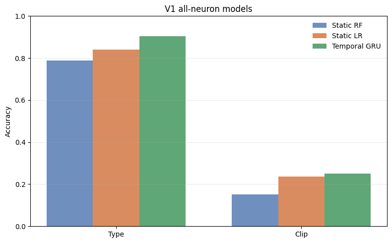
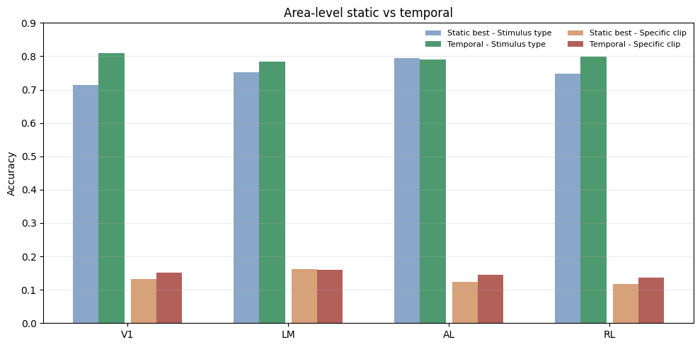

# Decoding Visual Stimuli from Neural Population Activity

**Static and temporal decoding of visual stimuli from calcium imaging of 7,493 neurons in mouse visual cortex (MICrONS dataset).**

Group project for *30563 Mathematical Modelling for Neuroscience*, Bocconi University (May 2026) · [Report (PDF)](report.pdf)

<p align="center">
  
</p>

## Questions

1. Can the **type of stimulus** a mouse is watching (natural movie, stylised Monet-like texture, or synthetic "Trippy" pattern) be read out from the activity of its visual cortex?
2. Can the **exact movie clip** be identified, out of 96?
3. Does the **temporal evolution** of population activity carry information beyond instantaneous snapshots?
4. How is this information distributed across four visual areas: **V1, LM, AL and RL**?

## Data

Session 4_7 of the MICrONS functional dataset: 464 trials and 7,493 neurons (V1: 5,312 · LM: 983 · RL: 811 · AL: 387).

- **Leakage control.** Repeated presentations of the same stimulus were deduplicated by video hash, so no stimulus appears in both training and test sets. The three categories were balanced at 20 unique stimuli each (chance: 1/3).
- **Clip identity.** Clips shown only once were dropped. For the 90 clips shown twice, one repetition is used for training and one for testing; the 6 clips shown ten times are split five and five. This gives a 96-class problem (chance: 1.04%).
- **Matched populations.** Because areas differ more than tenfold in size, cross-area comparisons subsample every area to 387 neurons (the size of AL), averaging over 30 random draws.

## Methods

- **Static decoders:** Random Forest and L2-regularised logistic regression on population snapshots, ignoring temporal order.
- **Temporal decoder:** a gated recurrent unit (GRU) on non-overlapping 10-timepoint windows, with neural activity first projected to a 64-dimensional latent space.
- **Interpretability:** feature importances for the static models and gradient saliency over neurons and timepoints for the GRU.

## Results

| Task (V1, all neurons) | Random Forest | Logistic regression | GRU | Chance |
|---|---:|---:|---:|---:|
| Stimulus type (3 classes) | 0.788 | 0.841 | **0.905** | 0.333 |
| Clip identity (96 classes) | 0.151 | 0.236 | **0.250** | 0.010 |

<p align="center">
  
</p>

- **Stimulus type is decodable well above chance in every area.** With matched 387-neuron populations the GRU reaches 0.78–0.81 in all four areas. This reflects differences in low- and mid-level visual statistics between the categories, not semantic coding in V1.
- **Clip identity is harder but clearly above chance.** LM leads the cross-area ranking (0.162 with the best static model), suggesting that intermediate areas carry more clip-specific information per neuron than V1.
- **Repetition matters.** Clips shown ten times are decoded far more accurately than clips shown twice: single presentations are dominated by trial-to-trial variability.
- **Temporal structure adds information.** The GRU outperforms both static decoders on all V1 neurons, and saliency peaks late in the response window, pointing to evidence accumulated over time. At matched population sizes the gain is largest in V1, smaller in RL and LM, and slightly negative in AL.
- **Information is distributed.** The most informative neurons are heterogeneous and only partially selective, rather than a few highly tuned cells.

**Limitations.** Decoding shows that information is present, not that the brain uses it in this form, and all results come from a single session.

## Repository structure

```
.
├── microns_decoding.ipynb   Full analysis: data inspection, static and temporal decoding, cross-area comparison
├── report.pdf               Two-page project report with appendix figures
├── requirements.txt
└── assets/                  Figures used in this README
```

## Running the notebook

The notebook expects the course's export of the MICrONS functional data (`microns.h5`) and the `microns_datacleaner` reader distributed with it, both in the notebook's folder; neither is included here. Intermediate datasets (`dataset_*.npz`) are generated by the notebook itself.

```bash
pip install -r requirements.txt
jupyter notebook microns_decoding.ipynb
```

## Authors

Victor-Gabriel Antonescu, Letizia Di Pietro, Martin Lukanov, Alexandru Stoica, Antonio Troiano (Bocconi University).

## Reference

MICrONS Consortium. *Functional connectomics spanning multiple areas of mouse visual cortex.* Nature 640, 435–447 (2025).
